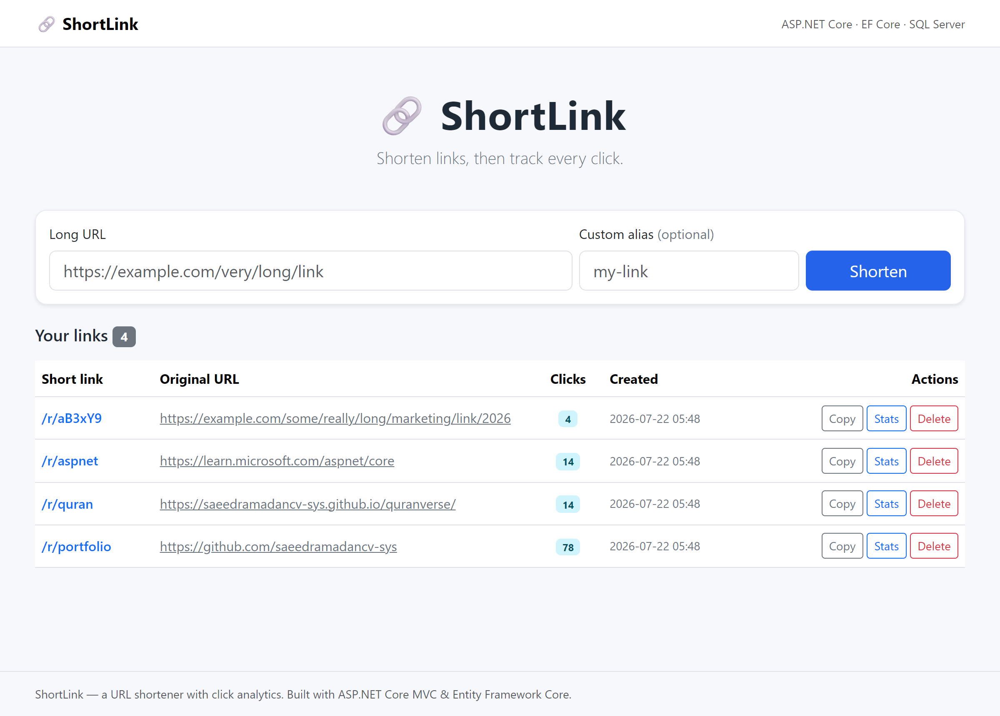
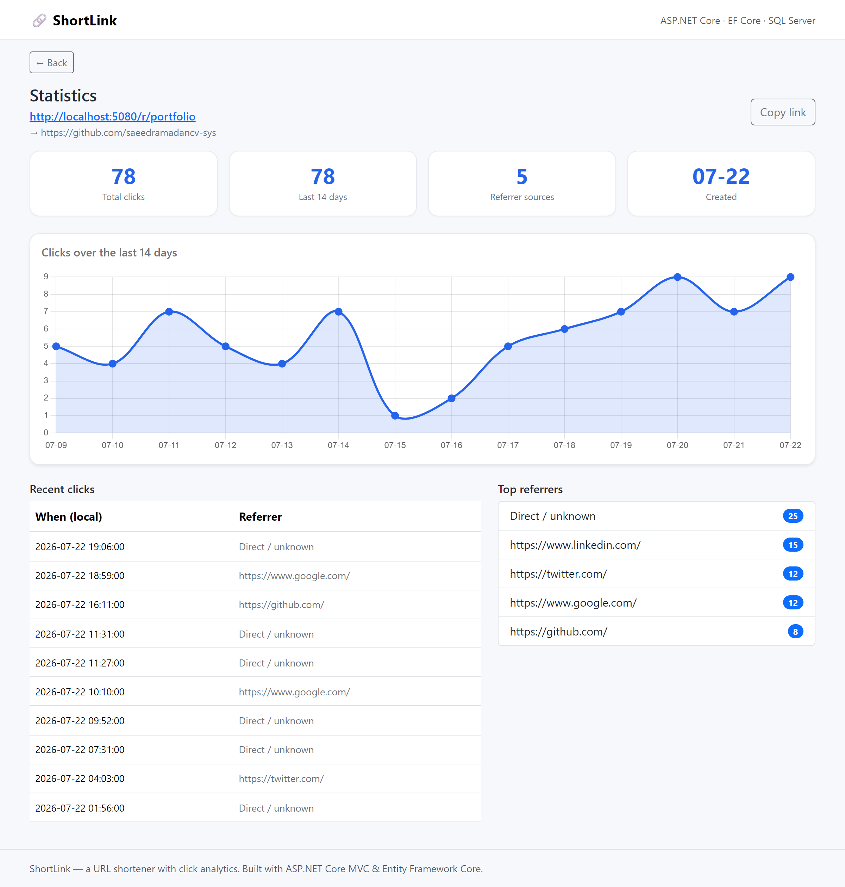

<h1 align="center">ShortLink: a URL shortener with click stats</h1>

<p align="center">
  A full-stack URL shortener built with <b>ASP.NET Core MVC</b> and <b>Entity Framework Core</b>.<br/>
  Shorten a link, share it, and see how many people clicked it, when, and from where.
</p>

<p align="center">
  <a href="https://url-shortener-cc59.onrender.com/"></a>
</p>

<p align="center"><sub>Hosted on Render's free tier, so the first request after a quiet period can take up to a minute.</sub></p>

<p align="center">
  
  
  
  
  
  
</p>

---

## What it does

- Shortens any http or https link, with a generated code or a custom alias you pick.
- Records every click: the time, the referrer and the browser's user agent.
- Gives each link its own stats page with total clicks, a 14-day chart (Chart.js), the latest clicks and the top referrers.
- Lists all links with their click counts, with buttons to copy or delete each one.
- Validates everything on the server (only http/https links, alias format, aliases that are already taken), and every form has anti-forgery protection.
- Runs on SQL Server by default, or on SQLite with one setting if you don't want to install a database.

---

## Screenshots

<p align="center">
  
  <br/><em>Home page: shorten a URL and see all links with their click counts</em>
</p>

<p align="center">
  
  <br/><em>Stats for one link: clicks over 14 days, latest clicks and top referrers (sample data from the demo seeder)</em>
</p>

---

## Tech stack

| Layer     | Technology                                   |
|-----------|----------------------------------------------|
| Framework | ASP.NET Core MVC (.NET 9)                    |
| Data      | Entity Framework Core (SQL Server / SQLite)  |
| Database  | SQL Server (LocalDB) by default              |
| Frontend  | Razor views, Bootstrap 5, Chart.js           |
| Language  | C#                                           |

---

## Getting started

You need the [.NET 9 SDK](https://dotnet.microsoft.com/download). For the default setup you also need SQL Server or SQL Server LocalDB (it comes with Visual Studio). You can skip that and use SQLite instead, see below.

### Run with SQL Server (default)

The connection string is in `appsettings.json` (`ConnectionStrings:SqlServer`, set to LocalDB by default). Then:

```bash
dotnet run
```

The database and tables are created on the first run. Open the URL shown in the console.

### Run without SQL Server (SQLite)

No database server needed. The app creates a local `urlshortener.db` file:

```bash
dotnet run --UseSqlite=true
```

### Load demo data (optional)

This adds a few links and some made-up click history, so the stats pages aren't empty:

```bash
dotnet run --UseSqlite=true --Seed=true
```

---

## How it works

1. **Create:** `POST /Home/Create` checks the URL, generates a unique 6-character code (or uses your alias) and saves a `ShortUrl` row.
2. **Redirect:** `GET /r/{code}` finds the code, saves a `Click` (time, referrer, user agent) and redirects (302) to the original URL.
3. **Stats:** `GET /Home/Details/{id}` turns the click history into a 14-day series, the latest clicks and the top referrers.

### Data model

```
ShortUrl (Id, Code [unique], OriginalUrl, CreatedAt)
    └── Click (Id, ShortUrlId, ClickedAt, Referrer, UserAgent)   // cascade delete
```

---

## A few decisions

### How short codes are generated

The easy way to make a short code is `Random`. I didn't use it for two reasons. `Random` is seeded from the clock, so codes can be predicted and someone could guess other people's links. And people read codes off screens, where `0` and `O`, or `1`, `l` and `I`, are hard to tell apart. So the generator uses `RandomNumberGenerator.GetBytes()`, which is cryptographically secure, over a 57-character alphabet with those look-alike characters taken out:

```csharp
private const string Alphabet = "abcdefghijkmnopqrstuvwxyzABCDEFGHJKLMNPQRSTUVWXYZ23456789";
```

The generator keeps trying until it finds a code that isn't used yet, and the `Code` column has a unique index behind it, because the database is the only place that can really guarantee uniqueness.

### The database is chosen at runtime

`Program.cs` picks the EF Core provider from configuration: SQL Server by default, SQLite with one setting, and no code changes either way. The live demo on Render runs on SQLite (`UseSqlite=true` in `render.yaml`), so it doesn't need a separate database. It also means you don't need SQL Server installed to try this repo.

### Protecting the write paths

| Risk | What I did |
|---|---|
| Cross-site request forgery | `[ValidateAntiForgeryToken]` on every POST action |
| `javascript:` / `data:` links | Only `http` and `https` are accepted, checked on the server |
| Strange custom aliases | Aliases must match `^[A-Za-z0-9_-]{3,32}$` |
| Taking someone else's alias | Checked before saving, with a unique index behind it |
| Huge `User-Agent` headers | Cut to 400 characters before saving |

### Async and deployment

Every database call uses EF Core's async methods, so requests don't block a thread while waiting on the database. Cascade delete is set up with the Fluent API. A multi-stage `Dockerfile` ships only the runtime image, `render.yaml` describes the Render service, and the app listens on the `$PORT` the host gives it, so the same image runs locally and in the cloud.

`GET /health` returns `Healthy` (200) or `Unhealthy` (503). It runs a real query against the `ShortUrls` table, so a missing database or table shows up as unhealthy even while the web server itself is still answering. An uptime monitor checks this URL.

---

## Project structure

```
url-shortener/
├── Controllers/HomeController.cs   # create, redirect, stats, delete
├── Data/AppDbContext.cs            # EF Core context + model config
├── Data/DemoSeeder.cs              # optional demo data (runs only with --Seed=true)
├── Models/                         # ShortUrl, Click, StatsViewModel
├── Views/Home/                     # Index (list + form), Details (stats)
├── wwwroot/css/site.css            # custom styling
├── Dockerfile                      # multi-stage build
├── render.yaml                     # Render service definition
├── appsettings.json                # connection strings + provider switch
└── Program.cs                      # DI, provider selection, routing, /health
```

---

## License

MIT, see [LICENSE](LICENSE).

---

**Saeed Ramadan**, .NET backend developer, Amman, Jordan
[GitHub](https://github.com/saeedramadancv-sys) · [LinkedIn](https://www.linkedin.com/in/saeedramadan-dotnet) · saeed.ramadan.cv@gmail.com
